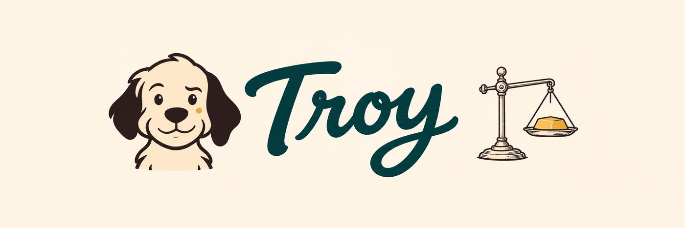
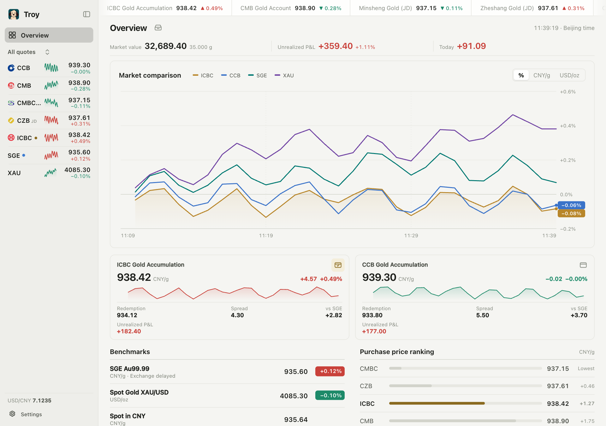

<p align="center">
  <picture>
    <source media="(prefers-color-scheme: dark)" srcset="assets/troy-banner-dark.webp">
    
  </picture>
</p>

<h3 align="center">Track bank gold accounts, Shanghai gold and international spot in one window.</h3>

<p align="center">
  <a href="https://github.com/Pixeldooooog/Troy/releases/latest"></a>
  <a href="https://github.com/Pixeldooooog/Troy/actions/workflows/ci.yml"></a>
  <a href="LICENSE"></a>
</p>

<p align="center">
  <b>English</b> · <a href="README.zh-CN.md">简体中文</a><br>
  <a href="#install">Install</a> ·
  <a href="#features">Features</a> ·
  <a href="#markets">Markets</a> ·
  <a href="#usage">Usage</a> ·
  <a href="#development">Development</a> ·
  <a href="#architecture">Architecture</a> ·
  <a href="#faq">FAQ</a>
</p>

---

Named for the troy ounce, Troy follows six bank gold accounts, Shanghai Gold Exchange Au99.99 and XAU/USD. Pin a quote to your Mac menu bar or check it from the Windows tray. Holdings, price targets and sampled history stay on your computer.

<a id="install"></a>

## 📦 Install

Download the latest build from [GitHub Releases](https://github.com/Pixeldooooog/Troy/releases/latest).

| Platform                          | File                                | Notes                                      |
| :-------------------------------- | :---------------------------------- | :----------------------------------------- |
| macOS 14+ (Apple Silicon & Intel) | `Troy-vX.Y.Z-macOS-universal.dmg`   | Open the DMG and drag Troy to Applications |
| Windows 11 x64                    | `Troy-vX.Y.Z-Windows-x64-setup.exe` | Run the installer                          |

> [!NOTE]
> The Mac app is ad hoc signed and not notarized, so allow it under **System Settings → Privacy & Security** on first launch. The Windows installer is unsigned and SmartScreen may warn. Every release ships a `SHA256SUMS.txt`.

<a id="features"></a>

## Reading the dashboard

<picture>
  <source media="(prefers-color-scheme: dark)" srcset="assets/overview-en-dark.webp">
  
</picture>

<sub>Local development build · simulated quotes · times in Beijing time (UTC+8)</sub>

| View                | What you can do                                                                                                                                                                                             |
| ------------------- | ----------------------------------------------------------------------------------------------------------------------------------------------------------------------------------------------------------- |
| **Holdings**        | See purchase price, redemption price and spread. Hover over a sparkline for the last quote in that minute. Pin an account from its card. Enter grams and cost for a portfolio valuation and unrealized P&L. |
| **Comparison**      | Hover or focus the chart and use the arrow keys to read the original price and unit for each market at one minute. Choose price, interval change or an index starting at 100.                               |
| **Market detail**   | Switch between intraday, 1- or 5-minute candles, and daily, weekly or monthly candles. Quote time and collection time have separate labels. Missing minutes leave gaps in the overview.                     |
| **Purchase prices** | Rank comparable CNY accounts and see each bank’s premium to the lowest quote within the comparison window.                                                                                                  |
| **Price alerts**    | Set a target per market. A qualifying quote at or below the target triggers once and re-arms after a rise above it. Reopen the window from the Mac menu bar or Windows tray.                                |
| **Settings**        | Use the gear at the bottom left to change language, theme, market colors and automatic update checks. When a new stable release is available, Troy offers to open its download page.                        |

<a id="markets"></a>

## 🏦 Markets

| Market                            | Unit   | Quote                                       | Poll |
| :-------------------------------- | :----- | :------------------------------------------ | ---: |
| ICBC gold accumulation            | CNY/g  | Purchase price, redemption shown separately | 15 s |
| China Merchants Bank gold account | CNY/g  | Customer purchase price, with redemption    | 15 s |
| CCB gold accumulation             | CNY/g  | Official purchase and redemption prices     | 30 s |
| Minsheng gold (JD Finance)        | CNY/g  | Reference price, no redemption              | 30 s |
| Zheshang gold (JD Finance)        | CNY/g  | Reference price, no redemption              | 30 s |
| UOB Gold Savings Account          | SGD/g  | Official bank sell and buy prices           | 60 s |
| Shanghai Gold Exchange Au99.99    | CNY/g  | Official delayed quote                      | 30 s |
| International spot gold XAU/USD   | USD/oz | Live proxy quote                            | 10 s |
| USD/CNY                           | —      | Used only for unit conversion               | 60 s |

**Quote time and collection time.** The table lists Troy’s polling interval. The public SGE table carries a trading date. Its intraday chart uses timestamps from the exchange’s minute feed. UOB sets its own indicative prices, which Troy polls every 60 seconds. Once the bank’s timestamp is more than five minutes old, Troy marks the quote stale and pauses price alerts for it. [SGE delayed quotes](https://www.sge.com.cn/sjzx/yshqbg) · [UOB gold prices](https://www.uob.com.sg/online-rates/gold-and-silver-prices.page)

**Comparing units.** The CNY/g price axis converts spot gold using the available USD/CNY reference rate and grams per troy ounce. The chart shows the rate used. The USD/oz axis shows the native spot price. Select a UOB holding to enable the SGD/g axis. For performance across currencies, choose interval change or the index, both based on each market’s first quote in the window.

<a id="usage"></a>

## 🚀 Usage

1. Open **Settings → Holdings** and tick the accounts you hold. Grams and cost are optional and enable P&L.
2. The **Overview** shows your holdings, relative performance, benchmarks and the price ranking. Click any card or ticker item for details.
3. On a market's page, **pin it to the menu bar or tray** or **set a price alert**.

| Shortcut                   | Action         |
| :------------------------- | :------------- |
| <kbd>⌘</kbd> <kbd>1</kbd>  | Go to overview |
| <kbd>⌘</kbd> <kbd>\\</kbd> | Toggle sidebar |
| <kbd>⌘</kbd> <kbd>,</kbd>  | Open settings  |

Use <kbd>Ctrl</kbd> instead of <kbd>⌘</kbd> on Windows.

On macOS, closing the window, pressing <kbd>⌘</kbd> <kbd>Q</kbd> or quitting from the Dock hides the window and Dock icon while sampling continues. Choose **打开 Troy** in the menu bar to bring it back and **退出 Troy** to quit.

<a id="development"></a>

## Local development

From the repository root on this development branch, start Troy with one command. The first run installs the locked frontend dependencies and compiles Rust.

```sh
make dev
```

| Command      | Purpose                                                                                                                 |
| ------------ | ----------------------------------------------------------------------------------------------------------------------- |
| `make dev`   | Start Troy Dev with live feeds, frontend hot reload, Rust recompilation and native logs in the terminal.                |
| `make mock`  | Open the dashboard in a browser with simulated quotes. Layout, themes and interactions need only Node.js, npm and Make. |
| `make check` | Run the format check, ESLint, chart tests, frontend build, Rust tests and Clippy.                                       |
| `make help`  | List local commands.                                                                                                    |

Use Node.js 22 LTS (22.13 or later in the 22 series) and npm. The desktop app also needs stable Rust. Install Xcode Command Line Tools on macOS, or MSVC C++ Build Tools, the Windows SDK and WebView2 on Windows. On Windows, use Git Bash with GNU Make or start native debugging directly from PowerShell.

```sh
npm ci
npm run tauri -- dev --config src-tauri/tauri.dev.conf.json
```

**Debugging.** Troy Dev has its own app identifier and data directory and can run alongside your installed Troy. The native development server uses `127.0.0.1:1430`, and browser mock mode uses `127.0.0.1:1431`. Right-click the development window and choose **Inspect Element** to open the inspector. Press `Ctrl+C` in the terminal to stop the session.

**Local data.** Each app stores its database at `v2/quotes.sqlite3` under its application data directory. The production Mac app imports v1 data on first launch. Use `TROY_DATA_DIR` for a disposable database directory. To run just the offline quote, conversion, alert and migration tests, use `cargo test --locked -p troy-core`.

<a id="architecture"></a>

## 🧭 Architecture

```text
.
├── Makefile                Local development, browser mock and checks
├── src/                    React + TypeScript window
│   ├── App.tsx               routing and shortcuts
│   ├── pages/                Overview · MarketDetail · Settings
│   ├── components/           Sidebar, Ticker, charts/ (candles, comparison, sparkline)
│   ├── hooks/                snapshot subscription, series data
│   ├── lib/                  typed IPC (api.ts), types, market constants, formatting
│   ├── i18n/                 zh / en strings
│   ├── store/                local preferences (language, theme, holdings)
│   ├── styles/               design tokens and per-area styles
│   └── mocks/                Tauri stand-ins for browser mode
├── src-tauri/              Tauri 2 host: window, menu bar/tray, IPC commands
├── crates/troy-core/       Rust core, runs without the desktop shell
│   └── src/                  feeds · market · monitor · storage
├── docs/                   architecture notes
└── .github/workflows/      CI and releases
```

Sampling, storage and alerts all run in one Rust process, so hiding, reopening or reloading the window never interrupts them. See the [architecture notes](docs/architecture/desktop-v2.zh-CN.md) (Chinese) for the design.

<a id="faq"></a>

## ❓ FAQ

<details>
<summary><b>How is the day change calculated?</b></summary>

Against the last quote this computer recorded on the previous Beijing calendar day, not the bank's official close. If Troy wasn't running that day there is no baseline and it shows "—".

</details>

<details>
<summary><b>Why value holdings at the redemption price?</b></summary>

It's what you would get if you sold now. Markets without a redemption price (the two JD Finance products) fall back to the purchase price.

</details>

<details>
<summary><b>Where are my holdings stored?</b></summary>

Only on this computer, in the window's local storage and `quotes.sqlite3`. Troy uploads no personal data.

</details>

<details>
<summary><b>Why are parts of the chart blank?</b></summary>

Charts only draw quotes this computer actually observed. Periods when the computer slept or a source was down stay blank instead of being interpolated.

</details>

<details>
<summary><b>Where did the Swift version go?</b></summary>

Troy 1.x was a native SwiftUI app for macOS. Troy 2 replaces it on both platforms and imports its data on first launch. The Swift source remains available under the `v1.*` tags.

</details>

## 🚢 Releases

On every push to main and every pull request, [CI](.github/workflows/ci.yml) runs ESLint, the Prettier check, chart tests, the frontend build, Rust tests and Clippy on macOS and Windows, then compiles the desktop host.

To release, bump the version in `src-tauri/tauri.conf.json` on main, then run the [Release](https://github.com/Pixeldooooog/Troy/actions/workflows/release.yml) workflow on **main** with the matching tag (for example `v2.0.2`), or push the tag. The pipeline rebuilds and tests on both platforms, builds the universal DMG and the Windows x64 installer, smoke-tests mounting, installation and launch, then publishes the release with SHA-256 checksums and verifies the public downloads.

## 📄 License

[MIT](LICENSE) © Pixeldooooog
