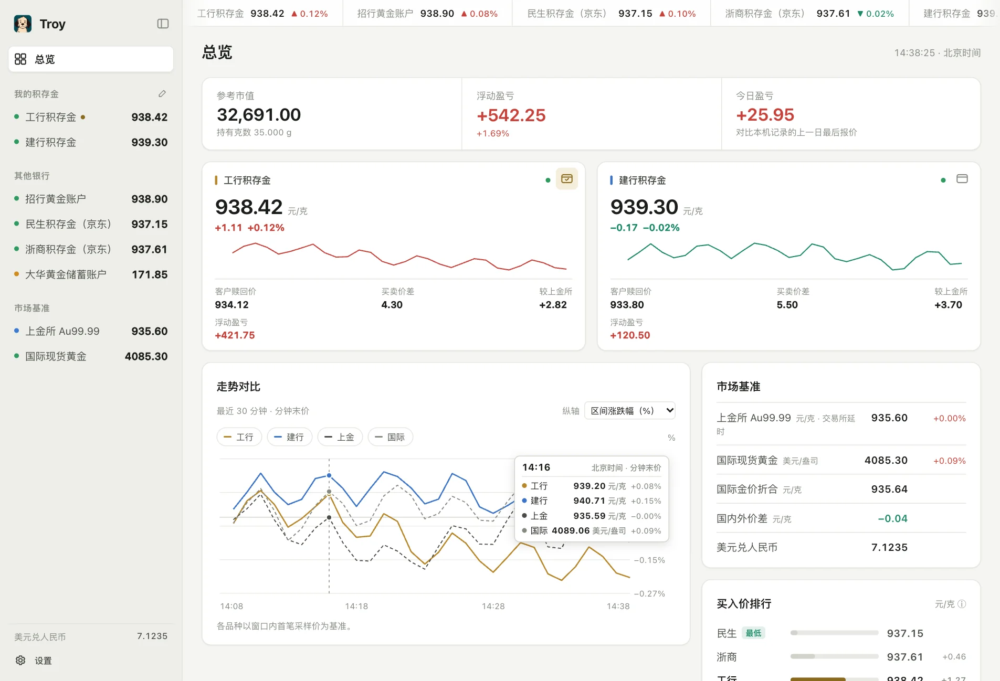

<p align="center">
  <picture>
    <source media="(prefers-color-scheme: dark)" srcset="assets/troy-banner-dark.webp">
    
  </picture>
</p>

<h3 align="center">跟踪银行积存金、上海金和国际现货金。</h3>

<p align="center">
  <a href="https://github.com/Pixeldooooog/Troy/releases/latest"></a>
  <a href="https://github.com/Pixeldooooog/Troy/actions/workflows/ci.yml"></a>
  <a href="LICENSE"></a>
</p>

<p align="center">
  <a href="README.md">English</a> · <b>简体中文</b><br>
  <a href="#install">安装</a> ·
  <a href="#features">看盘</a> ·
  <a href="#markets">数据源</a> ·
  <a href="#usage">使用</a> ·
  <a href="#development">本地开发</a> ·
  <a href="#architecture">架构</a> ·
  <a href="#faq">FAQ</a>
</p>

---

Troy 以金衡盎司命名。把常看的银行买入价固定到 Mac 菜单栏，在总览对比六家银行的报价、上金所 Au99.99 和国际现货金。Windows 通过系统托盘查看行情。持仓、价格提醒和采样历史保存在本机。

<a id="install"></a>

## 📦 安装

从 [GitHub Releases](https://github.com/Pixeldooooog/Troy/releases/latest) 下载最新版本。

| 平台                               | 安装包                              | 说明                               |
| :--------------------------------- | :---------------------------------- | :--------------------------------- |
| macOS 14+（Apple Silicon / Intel） | `Troy-vX.Y.Z-macOS-universal.dmg`   | 打开 DMG，把 Troy 拖进「应用程序」 |
| Windows 11 x64                     | `Troy-vX.Y.Z-Windows-x64-setup.exe` | 运行安装程序                       |

> [!NOTE]
> Mac 包使用 ad hoc 签名，未经 Apple 公证，首次打开需要在「系统设置 → 隐私与安全性」中允许。Windows 安装包未做代码签名，SmartScreen 可能会提示。每个版本都附带 `SHA256SUMS.txt` 用于校验。

<a id="features"></a>

## 看盘

<picture>
  <source media="(prefers-color-scheme: dark)" srcset="assets/overview-zh-dark.webp">
  
</picture>

<sub>本地开发版界面 · 模拟行情 · 图中时间为北京时间</sub>

| 在哪里         | 可以看到什么                                                                                                                                                                  |
| -------------- | ----------------------------------------------------------------------------------------------------------------------------------------------------------------------------- |
| **持仓卡片**   | 当前买入价、赎回价和价差。把鼠标移到小折线上看该分钟的末笔采样，点卡片右上角可固定品种。填写持有克数和成本后，还能看到参考市值与盈亏。                                        |
| **走势对比**   | 在图上移动鼠标，或选中图表后按左右方向键，查看同一分钟各品种的原价与单位。纵轴可切换价格、区间涨跌幅、首笔 = 100。                                                            |
| **品种详情**   | 切换分时、1 分或 5 分钟 K、日 K、周 K、月 K。报价与采集时间分开显示。出现采样空缺的分钟会在总览留白。                                                                         |
| **买入价排行** | 在可比较的时间窗内，将人民币积存金按买入价排序，显示与最低报价的差额。                                                                                                        |
| **到价提醒**   | 每个品种可设一个目标价。触及或低于目标时提醒一次，重新高于目标后恢复监测。关窗后可从菜单栏或托盘打开 Troy。                                                                   |
| **设置**       | 左下角齿轮可切换语言、外观、涨跌颜色、登录时启动和自动检查更新。发现 GitHub 正式版时，Troy 会提示你打开对应版本的下载页。有匹配的签名更新包时，也可以在设置中选择安装并重启。 |

<a id="markets"></a>

## 🏦 数据源

| 品种                   | 单位      | 报价                               | 轮询 |
| :--------------------- | :-------- | :--------------------------------- | ---: |
| 工商银行积存金         | 元/克     | 主动积存价，另显示赎回价           | 15 s |
| 招商银行黄金账户       | 元/克     | 客户买入价，另显示赎回价           | 15 s |
| 建设银行积存金         | 元/克     | 官网主动积存价与赎回价             | 30 s |
| 民生积存金（京东金融） | 元/克     | 接口参考价，无赎回价               | 30 s |
| 浙商积存金（京东金融） | 元/克     | 接口参考价，无赎回价               | 30 s |
| 大华银行黄金储蓄账户   | 新元/克   | 官网挂牌价：银行卖出价和银行买入价 | 60 s |
| 上海黄金交易所 Au99.99 | 元/克     | 官方延时行情                       | 30 s |
| 国际现货黄金 XAU/USD   | 美元/盎司 | 实时代理报价                       | 10 s |
| 美元兑人民币           | —         | 仅用于单位换算                     | 60 s |

**报价时间与采集时间。** 表中秒数是 Troy 的查询间隔。上金所的公开行情表提供交易日，分时图采用交易所分钟数据里的时刻。大华按自己的节奏更新参考价，Troy 每 60 秒查询一次。银行给出的时刻距当前超过 5 分钟时，界面标为「报价过期」并暂停该报价的到价提醒。[上金所延时行情](https://www.sge.com.cn/sjzx/yshqbg) · [大华黄金牌价](https://www.uob.com.sg/online-rates/gold-and-silver-prices.page)

**对比单位。** 人民币价格轴用当前可用的美元兑人民币参考汇率和金衡盎司克数折算国际金，图下列出所用汇率。美元轴显示国际现货原价，持有大华账户时可选新元轴。跨币种对比也可选涨跌幅或指数，每条线以窗口内的首笔报价为基准。

<a id="usage"></a>

## 🚀 使用

1. 打开 **设置 → 持仓**，勾选你持有的积存金。克数和成本价可以不填，填了就能看到盈亏。
2. 在 **总览** 查看持仓、走势对比、市场基准和买入价排行。点击任意卡片或行情可进入该品种的详情页。
3. 在详情页可以把品种 **固定到菜单栏或托盘**，也可以设置 **到价提醒**。

| 快捷键                     | 作用           |
| :------------------------- | :------------- |
| <kbd>⌘</kbd> <kbd>1</kbd>  | 回到总览       |
| <kbd>⌘</kbd> <kbd>\\</kbd> | 收起或展开侧栏 |
| <kbd>⌘</kbd> <kbd>,</kbd>  | 打开设置       |

Windows 上用 <kbd>Ctrl</kbd> 代替 <kbd>⌘</kbd>。

在 macOS 上，关闭窗口、按 <kbd>⌘</kbd> <kbd>Q</kbd> 或在 Dock 里选择退出，都只会隐藏窗口和 Dock 图标，采集继续进行。从菜单栏选择 **打开 Troy** 可以恢复窗口，选择 **退出 Troy** 才会结束进程。

<a id="development"></a>

## 本地启动与调试

在仓库根目录运行以下命令。首次启动会根据锁文件安装前端依赖并编译 Rust。

```sh
make dev
```

| 命令         | 用途                                                                                     |
| ------------ | ---------------------------------------------------------------------------------------- |
| `make dev`   | 启动使用真实数据源的 Troy Dev。前端支持热更新，Rust 改动会重新编译，原生日志在终端输出。 |
| `make mock`  | 在浏览器打开模拟行情界面，适合调整布局、深浅色与交互。只需要 Node.js、npm 和 Make。      |
| `make check` | 检查版本一致性和格式，运行 ESLint、Vitest、前端构建、Rust 测试和 Clippy。                |
| `make help`  | 查看本地命令。                                                                           |

使用 Node.js 22 LTS（22.13 或更高小版本）与 npm。桌面模式还需要稳定版 Rust。macOS 安装 Xcode Command Line Tools，Windows 安装 MSVC C++ Build Tools、Windows SDK 和 WebView2。Windows 可在装有 GNU Make 的 Git Bash 中运行上表命令，也可在 PowerShell 直接启动桌面调试。

```sh
npm ci
npm run tauri -- dev --config src-tauri/tauri.dev.conf.json
```

**调试环境。** Troy Dev 使用独立的应用标识和数据目录，可与日常使用的 Troy 同时运行。桌面开发服务使用 `127.0.0.1:1430`，浏览器模拟服务使用 `127.0.0.1:1431`。在开发窗口右键选择「检查元素」可以查看界面，终端按 `Ctrl+C` 停止调试。

**本地数据。** 数据库位于各自应用数据目录的 `v2/quotes.sqlite3`。正式版首次启动会接续 2.0.x 数据库，macOS 也会导入 1.x 数据。开发版的设置与持仓保存在独立的 SQLite 数据库中。设置 `TROY_DATA_DIR` 可以指定临时数据库目录。单独验证报价、汇率换算、提醒与迁移，可运行 `cargo test --locked -p troy-core`。

<a id="architecture"></a>

## 🧭 架构

```text
.
├── Makefile                本地启动、模拟行情和检查
├── src/                    React + TypeScript 主窗口
│   ├── App.tsx               页面切换与快捷键
│   ├── pages/                总览 · 品种详情 · 设置
│   ├── components/           侧栏、行情滚动条、charts/（K 线、对比图、迷你图）
│   ├── hooks/                行情快照订阅、总览数据、更新检查
│   ├── lib/                  IPC 封装 (api.ts)、类型、品种、持仓计算、格式化
│   ├── i18n/                 zh / en 文案
│   ├── store/                本地偏好（语言、主题、持仓）
│   ├── styles/               设计令牌与分模块样式
│   └── mocks/                浏览器模式下的 Tauri 模拟
├── src-tauri/              Tauri 2 宿主：命令、多语言托盘、数据迁移、开机自启、自动更新
├── crates/troy-core/       Rust 核心，可脱离桌面独立运行
│   └── src/                  feeds · market · monitor · storage
├── scripts/                version.mjs（统一设置 / 检查版本号）
├── docs/                   架构文档
└── .github/workflows/      CI 与发布
```

采集、存储和提醒都由同一个 Rust 进程负责。窗口隐藏、重新打开或刷新，都不会打断行情任务。设计取舍见 [桌面架构](docs/architecture/desktop-v2.zh-CN.md)。

<a id="faq"></a>

## ❓ FAQ

<details>
<summary><b>「日涨跌」是怎么算的？</b></summary>

数据源公布了昨收价时（国际金价、美元兑人民币）就用官方昨收价；否则对比本机记录的北京时间上一日最后一笔报价。鼠标悬停在涨跌上会显示用的是哪一种。前一天电脑没运行、又没有官方昨收价时，会显示「—」。

</details>

<details>
<summary><b>持仓市值为什么用赎回价？</b></summary>

赎回价才是你现在卖出能拿到的价格，所以用它算市值更接近实际。没有赎回价的品种（比如京东渠道的两款）会改用买入价。

</details>

<details>
<summary><b>我的持仓数据存在哪里？</b></summary>

只存在本机，具体是窗口的本地存储和 `quotes.sqlite3`。Troy 不联网上传任何个人数据。

</details>

<details>
<summary><b>为什么有些时段图表是空白的？</b></summary>

图表只画本机实际采集到的报价。电脑休眠或数据源不可用的时段会留白，不会做插值补线。

</details>

<details>
<summary><b>从 2.0.x 升级，哪些会保留？</b></summary>

从 2.1 起应用标识改为 `com.pixeldooooog.troy`（原为 `local.goldmonitor.desktop`）。首次启动时会复制旧数据库，行情历史、到价提醒和固定品种都会保留，旧文件原样留着。2.0.x 窗口里设置的语言、主题和持仓存在网页存储中，需要重新设置一次。macOS 会重新请求通知权限。

</details>

## 🚢 构建与发布

代码提交至 main 或发起 PR 时，[CI](.github/workflows/ci.yml) 在 macOS 和 Windows 上检查版本号一致性，运行 ESLint、Prettier、Vitest、前端构建、rustfmt、Rust 测试与 Clippy，并编译桌面宿主。Dependabot 每周提交分组的依赖升级。

**自动更新的一次性设置**：把更新签名私钥添加为仓库 Secret `TAURI_SIGNING_PRIVATE_KEY`（有密码再加 `TAURI_SIGNING_PRIVATE_KEY_PASSWORD`），对应公钥已写在 `src-tauri/tauri.conf.json`。这是 Tauri 对更新包的签名，与 Apple / Windows 代码签名无关。请备份私钥：丢失后，已安装的应用将无法校验之后的更新。

发布前运行 `npm run version:set -- 2.1.0` 并合并到 main，然后在 [Release](https://github.com/Pixeldooooog/Troy/actions/workflows/release.yml) 选择 **Run workflow**，分支选 **main**，填写对应标签（例如 `v2.0.2`）。也可以直接推送版本标签触发发布。

流水线在两个平台重新运行测试，构建 macOS 通用 DMG 和 Windows x64 安装包，验证架构、DMG 挂载及「应用程序」拖放入口、Windows 静默安装及两个平台的应用启动。两端成功后生成 SHA-256 清单和签名的 `latest.json` 更新清单，发布 GitHub Release，并回读公开附件校验。手动运行旧标签会从该标签的提交重新构建并校验已有下载；新标签在打包成功后创建。重试同一标签会保留已公开的附件。Mac 包采用 ad hoc 签名，Windows 安装包未经代码签名。

## 许可证

[MIT](LICENSE) © Pixeldooooog
